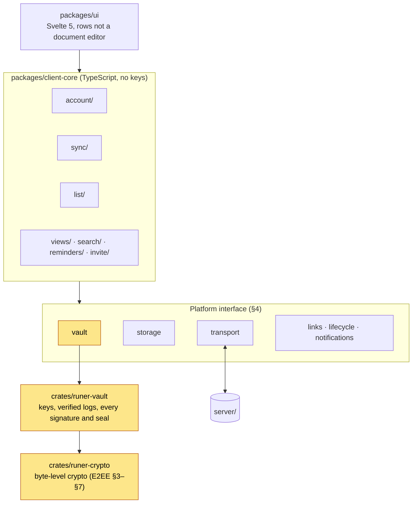
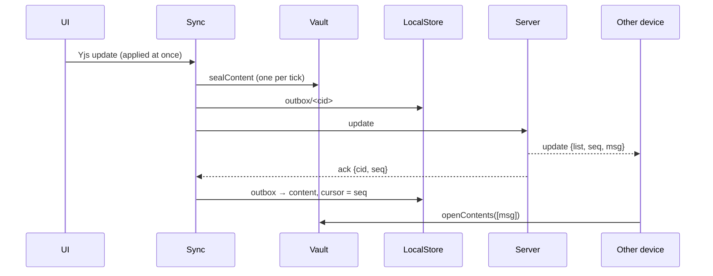

# The app

How the client is built: the Rust vault, the headless `client-core`, the Svelte UI and the Tauri shell.

The protocol is not repeated here. Its rules are in [E2EE](../protocol/docs/e2ee-protocol.md) (**E2EE §n**), [Sync](../protocol/docs/sync-protocol.md) (**Sync §n**) and the [API reference](../protocol/docs/api-reference.md); this page covers only the choices the protocol leaves to the client.

---

## 1. Goals and non-goals

- **Fast capture.** Adding or completing a task never waits on the network or on crypto.
- **One codebase** for macOS, Windows, Linux, iOS and Android (Tauri 2). Every platform capability sits behind an adapter (§4).
- **Keys stay in Rust.** The vault holds every key and verified log (§8); `client-core` does everything else that isn't UI. Both run unchanged in Node for tests.
- **Plaintext never touches disk** (E2EE §3.5), except reminder text in the OS notification store (§7.2). The device's log (§9) is plaintext too and holds no content.
- **Offline-first.** Edits queue in the outbox (Sync §4).

Not built: attachments, comments, recurring tasks, sub-tasks, calendar integration, team workspaces, granular access, per-device keys, ownership transfer, server push. Accepted trade-offs: the owner can't leave a list, deleting a list removes it for everyone, and lists are never archived.

---

## 2. Architecture



- **Dependency rule:** `ui` → `client-core` → `Platform`. Only the shells import a platform implementation; no `@tauri-apps/*` import outside `platform-tauri` and `apps/tauri` (lint rule).
- **Yellow holds keys.** TypeScript never sees a key, a raw signing operation or an unverified log. It holds handles and gets back plaintext bodies and verified list state.
- **What leaves the device** is ciphertext, signed log entries and public keys.

### 2.1 Layout (`app/`)

```text
app/
├── packages/
│   ├── client-core/        headless client; test/platform-node is the Node platform for tests
│   ├── ui/                 Svelte components and screens
│   └── platform-tauri/     TS side of the Tauri adapter
├── crates/
│   ├── runer-crypto/       byte-level crypto (§8)
│   ├── runer-vault/        keys, verified logs and their rules (§8)
│   └── runer-vault-node/   the vault as a Node add-on (napi-rs), for tests
├── apps/tauri/             one Tauri 2 project for desktop and mobile
└── e2e/                    client-core against the real server
```

---

## 3. `client-core`

| Module | Responsibility | Reference |
|---|---|---|
| `account/` | Sign-up, sign-in, silent re-auth, change of account key, settings | E2EE §3, §9 |
| `invite/` | Parsing invite links and the join flow | E2EE §6 |
| `sync/` | WebSocket, outbox, catch-up, Yjs provider; `logs.ts` fetches membership logs for the vault | Sync |
| `list/` | The list document (§3.1) | E2EE §5.1 |
| `views/`, `search/` | Today, My tasks and search over decrypted lists (§3.6) | |
| `reminders/` | Which notifications this device should have scheduled (§7.2) | |

No TypeScript decides who is a member: the vault verifies the logs and `client-core` shows its `ListState` (owner, members, epoch, open invites).

### 3.1 The list document

One Yjs document per list:

```text
name:   Y.Text
order:  Y.Array<item_id>
items:  Y.Map<item_id, Y.Map>   // {type: task|note, title, body?, done, due?, remind_at?, assignee?}; title and body are Y.Text
views:  Y.Map<view, item_id[]>  // Inbox only: the user's order of Today and My tasks
people: Y.Map<member id, name>   // §3.7
```

- **Tasks and notes, flat.** A note's `title` is Markdown: `#`–`###`, `-`/`1.` lists, `>`, `---`, bold, italic, code, strike; a line ending in `\` continues the block. The lines between two tasks are one note. No sub-tasks; a heading is a line of a note.
- **Text merges.** `title`, `body` and `name` are `Y.Text`, written as a diff between common prefix and suffix (never splitting a surrogate pair). Reads also accept a plain string. Other fields are last-writer-wins.
- **Fields.** `due` is a local date `YYYY-MM-DD`. `remind_at` is Unix ms; the UI shows it as a time on the `due` date, not as a separate reminder. `assignee` is a member's `identity_sign_pub` (base64url) from the verified log.
- **Unknown `type`s** from a newer client are shown as text and kept.
- **Moving between lists** keeps the id: insert into the target, then delete from the source. If a crash left both, the copy in the list with the smallest id wins.
- **Moving within a list** is delete + insert in `order`; reads skip repeats and unknown ids and append items missing from `order`.
- **Mutators return `false`** for an item that no longer exists, since a sync can remove it under the UI.

The UI never touches Yjs: `list/` exposes typed operations (`addTask`, `addNote`, `setTitle`, `toggleDone`, `setDue`, `setReminder`, `assign`, `move`, `remove`, `moveToList`).

### 3.2 Public API

One `ClientCore` per signed-in account (`client-core/src/core/`):

```ts
class ClientCore {
  static signUp(platform: Platform, server: ServerUrl, name?: string): Promise<{ core: ClientCore; accountKeyWords: string[] }>;
  static signIn(platform: Platform, server: ServerUrl, words: string[]): Promise<ClientCore | null>; // null: typo
  static resume(platform: Platform): Promise<ClientCore[]>;   // startup, from the cache

  server: ServerUrl;
  me: string;                                     // our identity_sign_pub
  signOut(): Promise<void>;
  changeAccountKey(): Promise<{ accountKeyWords: string[] }>;
  showAccountKey(): Promise<string[]>;

  lists: Readable<ListSummary[]>;
  inbox: ListId;
  createList(name: string): Promise<ListId>;
  list(id: ListId): ListHandle;                   // content, ops (§3.1), role, members, delete
  invites: InviteApi;

  today: Readable<TaskRef[]>;
  myTasks: Readable<MyTasks>;
  search(query: string): Promise<SearchHit[]>;

  connection: Readable<ConnectionState>;
  warnings: Readable<SecurityWarning[]>;
  stop(): Promise<void>;
}
```

- `Readable` is the Svelte store contract, so `client-core` doesn't depend on Svelte.
- `ListHandle.role` (`owner` | `member`) comes from the verified log; the UI hides owner-only actions. The owner deletes a list, members leave it.
- **A list can be made offline.** Its genesis waits in the local store (`created`) until the server takes it on the next connect.
- Accounts are identified by vault handle, server and `auth_pub`; nothing uses the server's `account_id`.

### 3.3 Security warnings

Each is a typed `SecurityWarning`, shown as a banner on every screen with a detail screen, until the vault clears it. There is no dismiss.

| Warning | Source |
|---|---|
| `log-fork` / `log-rollback` | E2EE §4.4 |
| `bundle-rollback` | A lower `bundle_gen` than seen (E2EE §3.3) |
| `withheld-removal` | Live update with an older epoch (E2EE §4.4) |
| `invite-already-used` | E2EE §6.2 |

A spent, revoked or expired link invite gives `InviteError('not-usable')` instead: the server answers all three with the same `410`, so the client can't tell them apart.

### 3.4 Sharing

- **Known contact first** (E2EE §6.3): anyone who is or was in a verified log of one of our lists. "Share with…" lists them before the link option; the vault builds the `add` only for keys from a verified log.
- **Link invite** (E2EE §6.1) for anyone else. Expires after 48 hours by default. The approve-first invite (E2EE §6.2) has no UI.
- **Rotation due** is the vault's call: `ListState.rotationDue` is `member-left` (any member's app rotates) or `invite-revoked` (only the owner's app rotates). The owner's app also rotates after an unused invite expires. A racing rotation loses with `409` and finds it no longer due.
- **Notices** are made only when a log this device already held grows; a log fetched from genesis replays silently, and our own entries make none.
- **Lost access.** A list someone else owns that the server stops listing is forgotten here with a `lost-access` notice ("You no longer have access to Groceries"), without saying whether it was deleted or we were removed.

### 3.5 Multi-server

The server URL is part of the account, so one user can be on several servers. Instances are keyed by `(server URL, auth_pub)`.

### 3.6 Views

- A task is "mine" when assigned to me or to nobody (the same rule as reminders).
- My tasks sits under Today: overdue and today, "Next 7 days", "Later". Undated tasks aren't listed.
- The order of Today and My tasks is kept in the Inbox document (`views`), so it syncs to the user's devices only. A task is dragged within its section only.

### 3.7 Account name and settings

- **The server holds no personal data.** Sign-up sends keys only.
- **Settings** are `{"v": 1, "clock": "12h" | "24h", "name": "…"}`, every field optional, sealed on the server (E2EE §3.3, `AccountSettings` in `src/account/`). Unknown fields are kept. A change applies at once and offline: kept in `LocalStore` tables `account-settings` and `account-settings-unsent` (sealed), sent in the background and at every start (`Account.syncSettings`); on `409` it refetches, reapplies and retries. Other devices see it at their next start.
- **The name is optional** and cleaned the same way everywhere (`cleanName` in `src/list/doc.ts`: trimmed, control characters and line breaks to spaces, direction overrides dropped, 60 characters).
- **Members read names from the list**, never from the server: each app writes its own name into the list's `people` map (`ClientCore.shareName`) when membership changes and when the name changes. A device that hasn't seen a change only fills an empty slot, and only once the list's content has arrived, so it can't write an old name back; clearing writes an empty entry for the same reason.
- **No name** shows as "Member 3FA2" (four hex digits of the signing key), the same on every device.
- **Names are untrusted.** They're cleaned again wherever they're read (`ListDoc.people`, `openInvite`). The `people` map is ordinary shared content, so a modified client could overwrite someone's entry; the safety code is the real check.
- **Invites carry the owner's name** (`owner_name`, E2EE §6.1), so Join can say "Anna invited you to a list". A link itself has no name.
- **The reminder privacy setting** is per device (§7.2).

---

## 4. The `Platform` interface

The only thing each shell implements (`client-core/src/platform/`):

```ts
interface Platform {
  vault: Vault;                 // keys, verified logs, every signature and seal (§8)
  storage: LocalStore;          // content ciphertext, outbox
  transport: Transport;         // HTTP + WebSocket to the server
  links: LinkSource;            // incoming invite links
  lifecycle: Lifecycle;         // foreground/background, online/offline
  notifications: Notifier;      // local reminders
  info: { kind: 'desktop' | 'ios' | 'android' | 'node' };
}

interface LocalStore {          // everything stored is already ciphertext
  get(table: string, key: string): Promise<Uint8Array | null>;
  put(table: string, key: string, value: Uint8Array): Promise<void>;
  delete(table: string, key: string): Promise<void>;
  range(table: string, prefix: string, opts?: { after?: string; limit?: number }): AsyncIterable<[string, Uint8Array]>;
  tx<T>(fn: (tx: LocalStore) => Promise<T>): Promise<T>;
}

interface Transport {
  request(method: string, path: string, body?: unknown): Promise<HttpResponse>;
  openSocket(path: string): Promise<Socket>;
}

interface Notifier {
  readonly maxPending: number;  // 64 on iOS
  replaceAll(reminders: { id: string; at: Date; title: string; body?: string }[]): Promise<void>;
  permission(): Promise<'granted' | 'denied' | 'prompt'>;
  requestPermission(): Promise<'granted' | 'denied' | 'prompt'>;
}
```

`Vault` (`platform/vault.ts`) hands out handles, never key bytes, and takes batches for bulk work. Only the vault touches the keychain.

### 4.1 Implementations

| Capability | Tauri (desktop, iOS, Android) | Node (tests) |
|---|---|---|
| `vault` | `runer-vault` behind Tauri commands; OS keychain (§6.2) | `runer-vault` via napi-rs; in-memory keychain |
| `storage` | SQLite written from Rust (`store` commands) | In memory |
| `transport` | Rust-side HTTP + WS that holds the cookie (§5) | Unit: `MemoryServer.transport()` (`test/platform-node/memory-server.ts`). e2e: the real server (`e2e/http-transport.ts`) |
| `links` | `tauri-plugin-deep-link` (§6.3) | Direct call |
| `lifecycle` | Window focus, `online`; app foreground on mobile | Manual |
| `notifications` | `tauri-plugin-notification`; iOS limit 64 | Recorder |

---

## 5. Networking and authentication

- **All HTTP and WebSocket traffic goes through Rust**, which holds the session cookie. No CORS, no webview cookies.
- **Origin.** The Rust transport sends `Origin: tauri://localhost` on everything.
- **Login** signs the URL the client connected to, never one the server supplies (E2EE §3.4).
- **Re-auth is silent**: the vault signs a new login when a session is lost or expired. If the server refuses it twice (`401 invalid_credentials`; once can be a stale challenge), the key changed or the account is gone: sync stops as `signed-out`, and the app shows a screen that clears this device and goes to sign-in with the 12 words. A network failure never does this.

### 5.1 Reconnect and lifecycle

Beyond Sync §2:

- Subscribe to every list on connect; Today needs all of them.
- On mobile, close the socket in the background and reconnect in the foreground.
- **Background refresh (iOS)** (`app.runer.refresh`, `src-tauri/src/wake.rs`): iOS runs it when it sees fit. Rust holds the wake and emits `runer://wake`; the webview claims it with `wake_pending`, on that event and once when it starts listening, for a wake that came before. It connects, catches up, reconciles and waits until settled (at most 20 s), waits until the reminders are with the OS, closes the socket again and calls `wake_done`. Rust ends the run after 25 s if the webview doesn't.
- **Reconcile** (`GET /v1/groups`, catch up changed logs, `checkHead`, drop lost lists, add new ones) on a `group` frame, on foreground, hourly and after a `forbidden`.

### 5.2 Sync

`client-core/src/sync/sync.ts` keeps one `Replica` per list (its `ListDoc`, `since`, held catch-up and snapshot counters) and runs frame handling, list refreshes and sealing one at a time on one promise queue, so a refresh delays sending but never editing.



- **Edits in one tick become one update** (`Y.mergeUpdates`, sealed once per microtask).
- **`since` moves on our own `ack`s too**, once `synced` for the list has arrived (Sync §4, ordering per connection). Without it a device that writes alone would never snapshot.
- **Snapshots** follow Sync §7. Only our own acknowledged snapshot replaces stored content; others' are stored beside the updates (E2EE §7).
- **Write errors:** `stale-epoch` catches up the log, opens our outbox items with the old key in the vault and seals them again (no plaintext outbox). `rate-limited` resends after 1 s. `forbidden`, `too-large` and `bad-request` drop the item; the edit stays in the document and goes out with the next snapshot.

---

## 6. Tauri shell (`apps/tauri`)

### 6.1 Rust side

| Module | Purpose |
|---|---|
| `store` commands (`rusqlite`) | `LocalStore`: `store_get`, `store_range`, `store_write` (one batch, all or nothing). No SQL reaches the webview; the vault's file is separate |
| `net` commands (`reqwest`, `tokio-tungstenite`, rustls) | `Transport`. Own cookie jar per server origin, so the `Secure` cookie also reaches an `http://` dev server; in memory only |
| `vault` commands | `runer-vault` on the keychain and its own SQLite file. Bytes cross IPC as base64url. Without a keychain every call fails with `Storage` and the UI says why |
| `notify` commands | Desktop: the plugin shows notifications at once, so Rust keeps the schedule and fires each reminder while the app runs |
| `tauri-plugin-deep-link` | `runer://join`, forwarded as the `runer://link` event; `links_initial` |
| `tauri-plugin-updater` | Desktop; registered only when the release workflow adds `plugins.updater`, so a local build never updates itself. Checked at start from Rust, which verifies the download's signature; macOS and Linux install it at once, Windows keeps it. The `runer://update-ready` event shows "Restart to update", and `update_restart` (refused until then) installs it on Windows and restarts. No other updater command reaches the webview |
| `tauri-plugin-single-instance` | Desktop: a second launch hands over to the running app |

**Lockdown.** The one capability (`capabilities/default.json`) grants the app's own commands and event listening; no plugin command, filesystem, shell or HTTP reaches the webview. CSP is `'self'` only, `connect-src` IPC only.

**macOS window:** overlay title bar; the UI keeps `--titlebar` (36px, `apps/tauri/src/chrome.ts`) free and drags the window there.

### 6.2 Secret storage

| OS | Backend |
|---|---|
| macOS, Windows | `keyring` crate (Keychain, Credential Manager) |
| Linux | Secret Service via `keyring`. No daemon: fail loudly, never fall back to plaintext |
| iOS | Keychain via the Security framework (`OsKeychain` in `src-tauri/src/device.rs`), `AfterFirstUnlockThisDeviceOnly`; a write deletes then adds so the class sticks |
| Android | Keystore-wrapped key; there is no Android build yet |

### 6.2a Platform notes

- **Notifications.** On iOS the plugin reads a scheduled time as local, so it is passed shifted by the time zone offset. On macOS it ignores schedules (§6.1).
- **`runer://`** registers only in an installed build, not in `cargo tauri dev`.
- **iOS builds** need `rustup component add llvm-tools`: Xcode 27 makes Swift `@_cdecl` exports local in Release, and `scripts/ios-swift-helpers.sh` (run after "Build Rust Code") makes the `SwiftRs` ones global again. Xcode needs `ENABLE_USER_SCRIPT_SANDBOXING = NO` and `cargo` on its PATH, and the crate builds no `cdylib` for iOS.

### 6.3 Invite links

- A link is `https://<server>/join#s`; the server's `/join` page hands it on as `runer://join?host=…#s`, the same on every platform. It can also be pasted where a list is added.
- **The fragment never leaves the parser**: not to the server, logs or anywhere else (unit-tested).
- **Links are shared by copying.** The app keeps no copy of the secret; "re-send" makes a new link.
- **Joining needs an account on the link's server.** A link received while signed out waits until sign-up or sign-in. Join refuses a link for another server (`other-server`).
- Text that looks like a link but isn't an invite never becomes a list name.

### 6.4 Webview minimums

Tauri 2's defaults: macOS 10.13, iOS 15, Windows 10 with Evergreen WebView2, Android API 24, Linux with `webkit2gtk-4.1`. Raise one only when the UI needs it.

---

## 7. UI (`packages/ui`)

- **Svelte 5, own editor over rows.** No Tiptap or ProseMirror. Markdown is parsed into elements (`ui/markdown.ts`), never into HTML. URLs show as text, never as links.
- **A list is a page edited in place.** Enter after a task starts a task, Enter on an empty task row starts text, Shift+Enter is a new line in a block. `/` and Markdown prefixes change a line's type; so does its gutter badge. Drag by the gutter handle or Alt+↑/↓.
- **Notes regroup** (`ui/blocks.ts`): rearranging lines keeps a note's id where it can, so concurrent edits stay on one item.
- **Saves** happen when a block is left or split, so one edit is one sealed update. The time field is plain text (`dates.ts`, `parseTime`), not `type="time"`.
- **Typed dates.** "Call mom tomorrow 9:30" in a new task sets the date and time and leaves "Call mom". A chip shows what was read; Escape keeps the words. The parser is `client-core/src/nl/` (`parse.ts`, one data file per language with its test examples); the UI passes it the device's clock. Repeats aren't read.
- **Layout:** one responsive tree. Desktop: sidebar and list. Mobile: tab bar and stack. Touch targets ≥ 44 px, no hover-only actions.
- **Quiet security:** a small "Encrypted" marker.
- **Strings** live in one catalogue (`messages.ts`); the product name is one constant.

### 7.1 Screens

| Screen | Requirements |
|---|---|
| Welcome | Create account / Sign in; a self-hosted URL behind a small link |
| Create account | Show the 12 words once, confirm 3, offer a recovery sheet. Creates the Inbox |
| Sign in | 12 words with BIP-39 autocomplete; checksum checked before any request |
| Today | Start screen: capture field (to Inbox) and My tasks across lists |
| Inbox, List | The page of tasks and text; members line; offline indicator; never blocks on the network |
| Task detail | Done, title, description, date (with optional time), assignee (this list's members), list |
| Share list | Owner only. Members, known contacts, link invite, pending invites (revoke), one "Show safety codes" line, remove ("keeps what they've already seen") |
| Join | Shows the list and inviter's name from the package, then sign in or up, then join |
| Settings | Show/change account key, notifications, name, appearance, sign out, delete account (`ClientCore.deleteAccount`: leaves others' lists, then `DELETE /v1/account`) |
| Help | What can be typed, from the parser's own examples |
| Security warnings | Banner and detail for every `SecurityWarning` (§3.3) |

**Appearance** is a theme (Default, Moss, Harbor, Ember) and a mode (System, Light, Dark), for this device and not the account. It lives in the webview's `localStorage` (`appearance.svelte.ts` in `packages/ui`), outside `LocalStore`, because it holds before sign-in and is read synchronously before the first paint. The entry calls `startAppearance()`, which sets `data-theme` and `data-mode` (light or dark, resolved from the system setting for System) on the root element. The colors are tokens in `theme.css`, one block per theme and mode; a new theme is one more pair of blocks and a name in `THEMES`.

### 7.2 Reminders

Computed on the device. After every change, at most once per tick, `reminders/` plans the reminders for tasks with `remind_at` that are assigned to the user or to nobody, and calls `notifications.replaceAll` with the nearest `maxPending` when the set changed. Past reminders are dropped.

- **Text:** the task title, list name as body. A per-device privacy setting (`LocalStore` table `settings`, plain JSON, the one non-ciphertext value) switches to a generic title with no body, since scheduled notifications sit in plaintext outside the app.
- **No push.** A device knows a reminder only once it has synced, so one set elsewhere may not fire, a moved one may fire late, and every device fires its own. On iOS the background refresh (§5.1) may sync in between, but iOS decides when: a few times a day at best, not in Low Power Mode, with Background App Refresh off, or after the app is swiped away.

---

## 8. The vault and the crypto

Keys, crypto and membership logs run in Rust so that JavaScript in the webview, the part most exposed to compromise (a malicious npm package, say), can't copy keys out. Calls cross the boundary in batches: per-item calls are what's slow.

- **`runer-crypto`**: stateless byte-level crypto (E2EE §3–§7), checked against `protocol/vectors`.
- **`runer-vault`**: holds the Account Key (in the keychain), the identity, list keys per epoch and every list's verified log. It verifies logs (canonical form, signatures, rules 1–12, fork and rollback), and builds, signs and seals everything the client sends. It must agree with the Go validator on every file in `protocol/log-fixtures`.

What it guarantees even to a compromised webview:

- **No key leaves it**, except the 12 words on the two screens that show them.
- **Key material moves only where verified state allows**: a list key to members of the verified log, an `add` only for an identity from a verified log, an invite package only for an invite open in the log.
- **It signs only what it builds** from typed arguments and its own state, never caller-supplied bytes.

So a compromised webview can act as the user while the compromise lasts, but it can still read whatever is decrypted. Therefore:

- **Runtime dependencies of `client-core` and `ui` need the owner's approval.** Approved: `svelte`, `yjs`. Lockfile changes are reviewed like code.
- **Nothing is loaded at run time** (§6.1).
- **Crypto dependencies** (`ed25519-dalek`, `x25519-dalek`, `hkdf`, `hmac`, `sha2`, `aes-gcm`, `hpke`, `bip39`, `zeroize`, `getrandom`) are a security decision to change. Randomness comes from the OS; secrets are zeroized.
- **Vectors** are generated by `crates/runer-crypto/tests/generate.rs` (`VECTORS_WRITE=1 cargo test -p runer-crypto --test generate the_committed`) and must also pass the Go check (`go test ./internal/cryptovectors/ ./internal/sync/` in `server/`).

### 8.1 Logs in the vault

- **Same checks, same order, same reasons as Go** (`validate_entry`; `tests/log_fixtures.rs` pins each reason), including Go's base64url and JSON escaping quirks.
- **A fork keeps nothing.** If `applyLog` meets a different entry at a known seq, it drops the batch and returns `log-fork`.
- **`checkHead`** compares each head from `GET /groups` with the verified log: lower is `log-rollback`, a different hash is `log-fork`. Catch-up refetches from our own head, so a swap there is caught too.
- **`applyLog` checks the genesis against the list id** (`WrongList`).
- **The vault stores logs, not keys.** Logs are re-verified from genesis at startup, which reopens the keys; a log that no longer verifies is dropped and refetched. The one key from outside a log, a link invite's `K_e`, is stored on its own (`key/<account>/<list>/<epoch>`). A store whose cache key is gone is cleared.

---

## 9. Local data

| Data | Where |
|---|---|
| Account Keys (`account/<handle>`), device cache key (`cache-key`) | OS keychain, read only by the vault |
| Identity secrets, bundle_gen, server (`acct/<handle>`); verified log entries (`log/<handle>/<list>/<seq>`) | Vault store, sealed under the cache key |
| Updates and snapshots (`<handle>/<list>/u/<seq>`, `/s/<covers_seq>`), cursor (`since`), outbox (`<cid>`) | `LocalStore`, server ciphertext unchanged |
| Yjs documents, search index, Today, My tasks | Memory only |
| Scheduled reminders | OS notification store, plaintext (§7.2) |
| The log (`debug.log`, at most 256 KB; `debug.ids`, the ids behind its labels) | App data directory, plaintext; holds no content |

The vault store is a SQLite file written from Rust (memory in Node); TypeScript can't read or roll it back. Sign-out (`Sync.signOut`) deletes the account from the vault, all its `LocalStore` rows and its scheduled notifications, and empties the log.

The log says what the app did, so a problem on someone's device can be read there: start, version and OS kind, foreground and background, sign-in and sign-out, the sync's connection and catch-up, updates, every step of a reminder, uncaught errors and panics. It stays on the device; nothing sends it, and Settings → Diagnostics shows it with Copy and Clear. It holds events, counts and durations. Content, list names, keys, invite ids and the 12 words never reach it; `debuglog.rs` replaces anything shaped like an id with a label that means something only within this log (`list-1`), errors are reduced to a code or fixed text (`logReason`), and reminder lines hold no title, list or absolute time.

---

## 10. No browser version

A browser app would load its code from a server on every visit, so whoever controls that server could take the keys. The server's `/join` page only hands a link to the installed app. The design preview (`npm run design -w @runer/ui`) runs the real UI on sample data and is never shipped.

---

## 11. Testing

| Suite | What | Run by |
|---|---|---|
| `cargo test` | Vectors, Ed25519 edge cases, log fixtures, vault behaviour | `make test` |
| vitest (`client-core`, `ui`) | List, views, search, reminders, invite links; the vault through the add-on; the sync engine against an in-memory server; components | `make test` |
| e2e (`e2e/against-server.sh`) | `client-core` with the real vault against the real server and PostgreSQL: sharing, removal, concurrent edits, stale-epoch resend, the adversarial proxy, a plaintext canary | `make test`, CI |
| Smoke | Sign up → add a task → restart → still there; reminders on a real phone | By hand |

The in-memory server checks little of what the real one does; the e2e suite is what holds the app to the server. There is no WebDriver test: Tauri's driver runs only on Linux.

---

## 12. Build and release

`.github/workflows/app-release.yml` builds signed-for-update installers for macOS (`.dmg`, self-signed so the keychain keeps trusting it), Windows (`.msi`, `.exe`) and Linux (AppImage, `.deb`, `.rpm`) from an `app-v*` tag, published as a release once all of them are built. Setup: [releasing.md](releasing.md).

The updater key is part of the trusted base (E2EE §1): releases are built only in CI, the key lives in CI secrets and an offline backup, and the app contacts only its server and the update feed (no analytics). If the key leaks, users must reinstall by hand.

---

## 13. Where each name is written

A rename or a fork touches only these places. Changing the label prefix changes every derived key, so existing accounts and lists can no longer be opened.

| What | Where |
|---|---|
| Label prefix `runer/v1/` | `crates/runer-crypto/src/labels.rs`, then regenerate `protocol/vectors`; the server has its own copy |
| Link scheme `runer` | `APP_SCHEME` in `packages/client-core/src/invite/link.ts`; `plugins.deep-link` in `tauri.conf.json`; the server's `/join` page |
| App id `app.runer` | `identifier` in `tauri.conf.json`; `DEV_CONFIG` in `Makefile` and `.cargo/run-signed.sh` (`app.runer.dev`); `apps/tauri/src-tauri/gen/apple` |
| Product name `runer` | `PRODUCT_NAME` in `packages/ui/src/product.ts`; `productName` and window `title` in `tauri.conf.json`; `apps/tauri/index.html` |

Dev builds are a separate app (`app.runer.dev`, "runer dev") with their own data and keychain entries. `RUNER_PROFILE=<name>` gives a debug build its own data directory and keychain service, so `make dev2` runs a second account beside the first.
