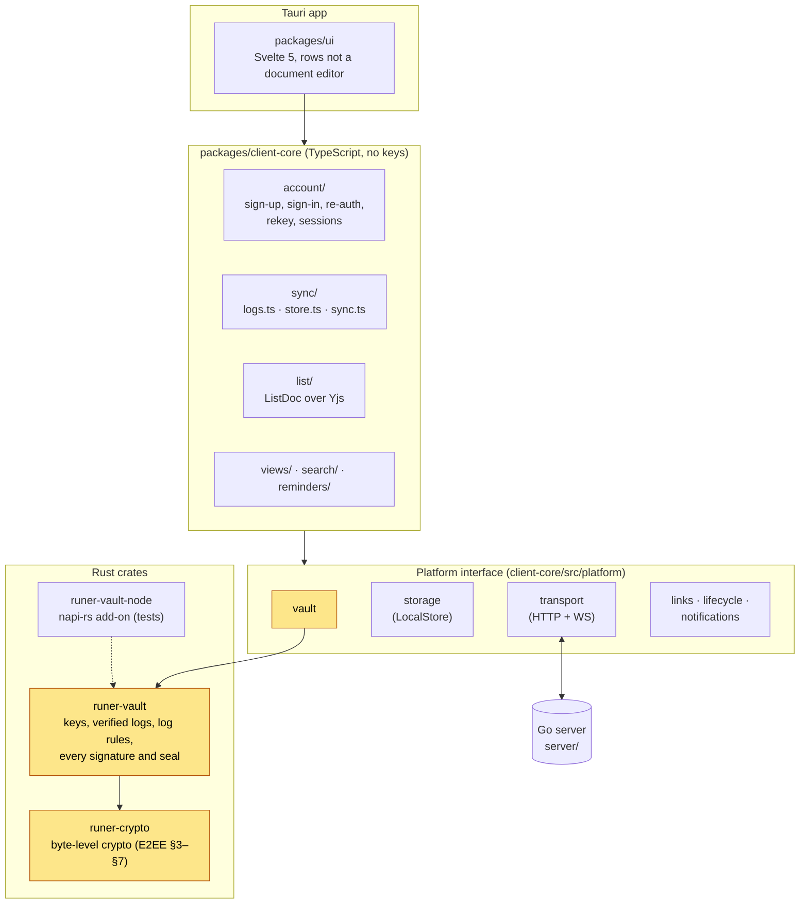
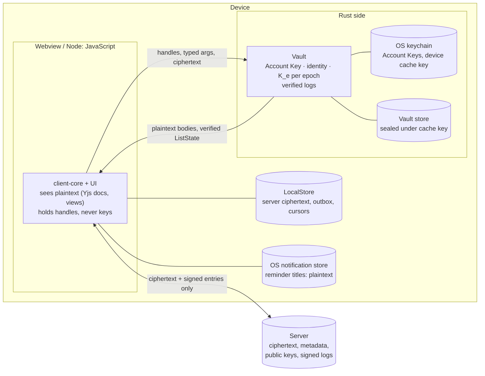
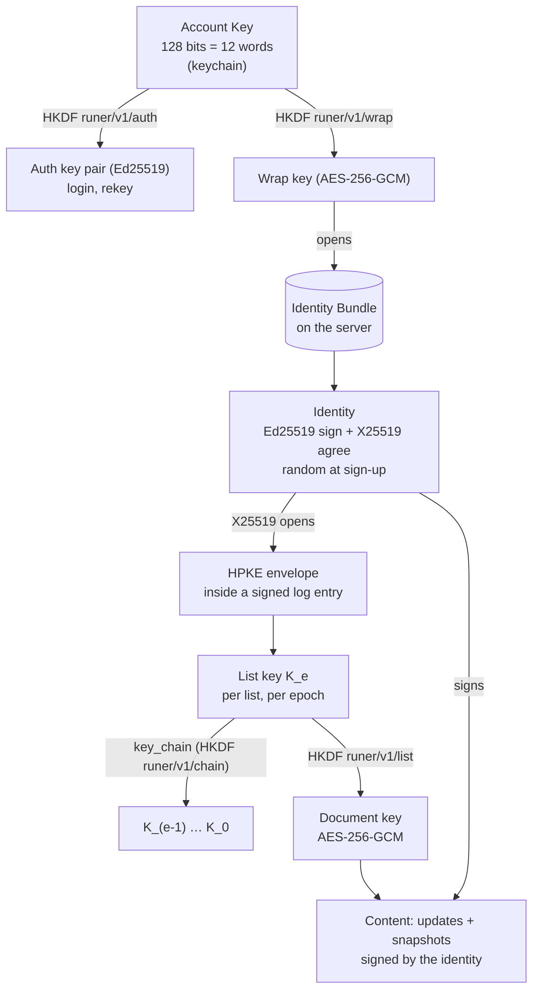
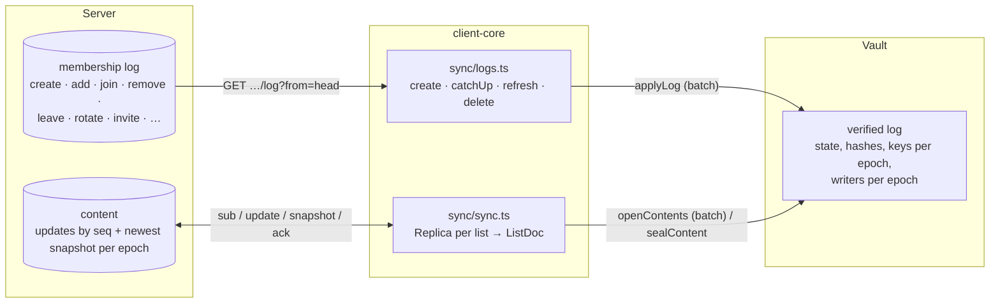
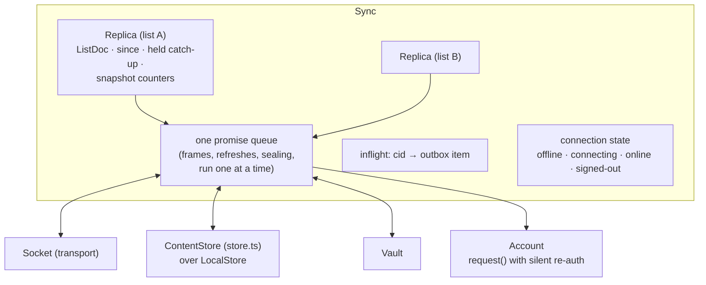
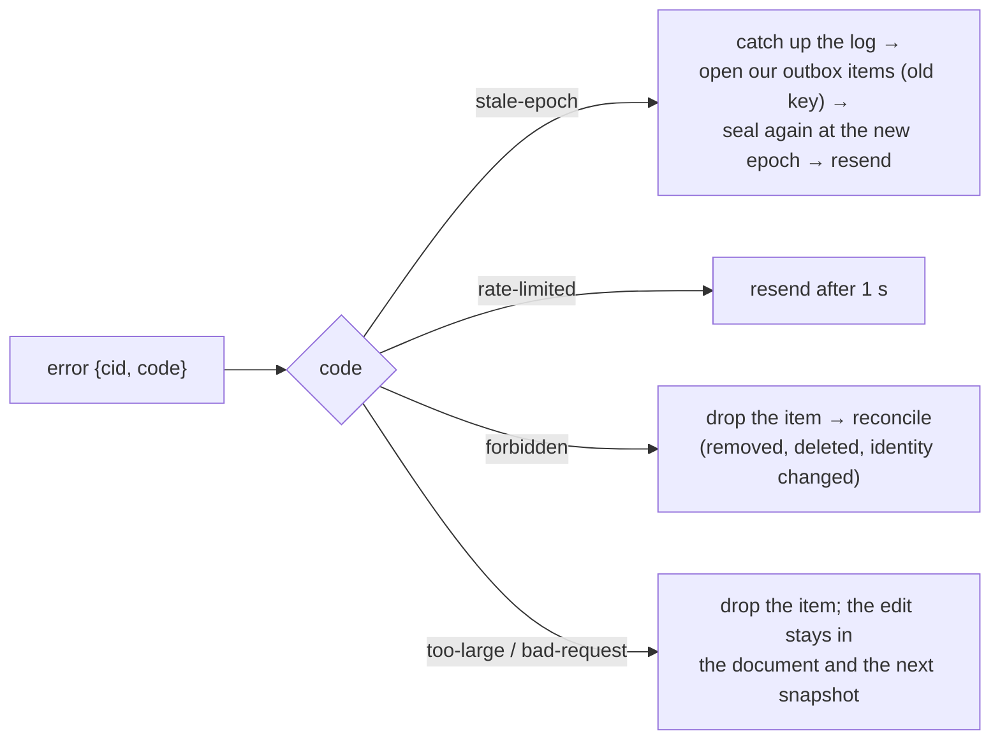
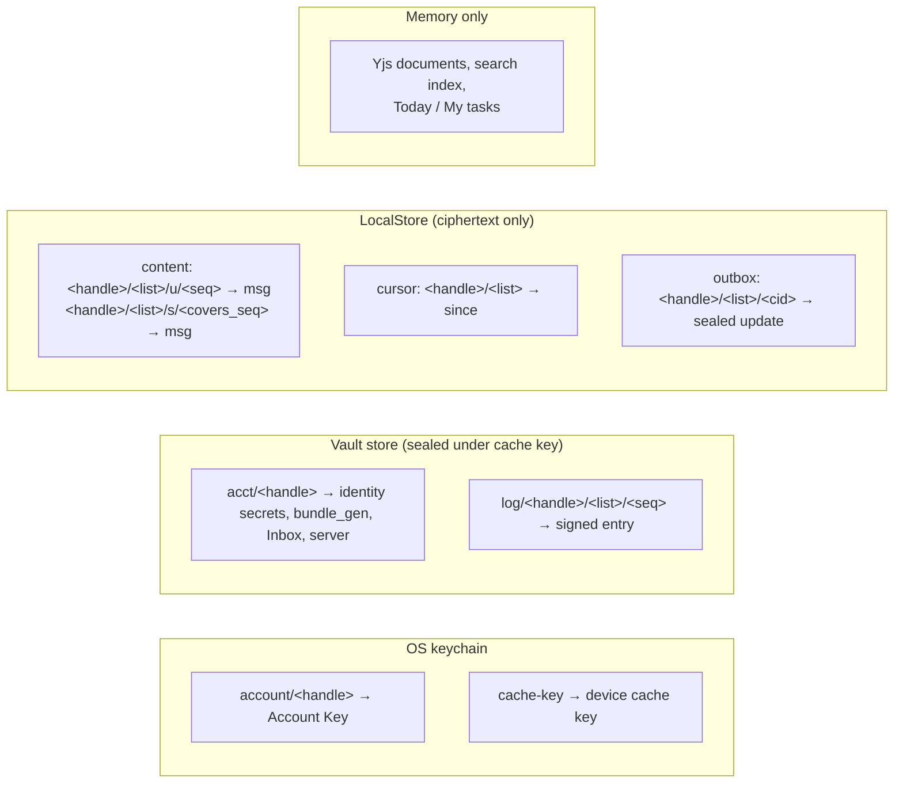
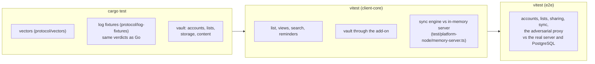
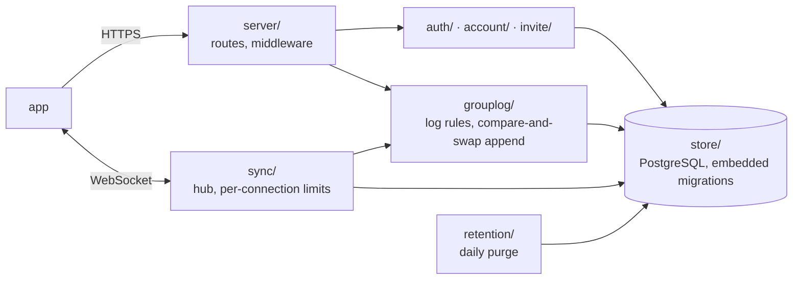

# Architecture

How the app and the server are put together. It is a map: the rules are in the protocol docs ([E2EE](../protocol/docs/e2ee-protocol.md), [Sync](../protocol/docs/sync-protocol.md), [API](../protocol/docs/api-reference.md)) and, for the app, in [client-spec.md](client-spec.md); they win where this page is shorter. Sections 1–8 are the app, section 9 the server. Diagrams are Mermaid (GitHub renders them).

---

## 1. Layers



- **Dependency rule:** `ui` → `client-core` → `Platform`. Only the shells import a platform implementation; nothing outside the Tauri packages imports `@tauri-apps/*` (lint rule).
- **Yellow = holds keys.** Nothing in TypeScript sees a key, a raw signature operation or an unverified log.
- The vault is the same Rust crate everywhere: behind Tauri commands in the app, through the napi-rs add-on in Node tests.

---

## 2. Trust boundaries



What each boundary guarantees (client-spec §8):

- **Vault → JavaScript:** no key bytes cross, except the 12 words on the two screens that must show them. Key material moves only where the verified log allows: a list key is sealed only to members of that list's verified log. The vault signs only what it builds from typed arguments and its own state.
- **Device → server:** only ciphertext, signed log entries and public keys. A malicious server can withhold and observe metadata, but can't read, forge edits or add members (E2EE §1).
- **Disk:** plaintext never touches it, except reminder text in the OS notification store, which the privacy setting can make generic (client-spec §7.2).

---

## 3. Keys



- **Change of account key** (E2EE §9.2) re-seals the same identity under a new Account Key: collaborators notice nothing.
- **A new epoch** (removal, leave + rotate, uninvite) brings a fresh random `K_e`, sealed to each remaining member. `key_chain` opens every older key, so one envelope gives a new member the whole history.
- The device cache key (keychain) seals the vault's own store. The vault keeps verified log entries, not list keys, and re-derives the keys at startup by verifying the logs from genesis.

---

## 4. A list: membership log and content

Each list has two streams on the server: the **membership log** (HTTP, signed entries, verified by the vault) and the **content log** (WebSocket, encrypted Yjs updates and snapshots).



- The vault checks every log entry against E2EE §4.2 (rules 1–12, the same verdicts as the Go validator on every fixture), detects fork and rollback against the server's head, and opens our envelopes.
- Content opens only if its author was a member during its epoch in the verified log, the signature verifies, and the vault holds that epoch's key. A miss on epoch or author makes `sync` catch up the log and try once more.

---

## 5. Sync engine (`client-core/src/sync/sync.ts`)

### 5.1 Parts



Triggers that refresh every log (`reconcile`: `GET /v1/groups`, catch up changed logs, drop lists we lost, add and subscribe new ones): a `group` frame (including the one per list the server sends at connect), the app coming to the foreground, the hourly timer, and a `forbidden` error.

### 5.2 A local edit reaching another device

```mermaid
sequenceDiagram
  autonumber
  participant UI
  participant Doc as ListDoc (Yjs)
  participant S as Sync
  participant V as Vault
  participant LS as LocalStore
  participant Srv as Server
  participant B as Other device

  UI->>Doc: addTask("milk")
  Note over UI,Doc: applied at once; never waits on network or crypto
  Doc-->>S: Yjs update (origin ≠ REMOTE)
  S->>S: merge every update from this tick
  S->>V: sealContent(list, update)
  V-->>S: {header, nonce, ct, sig} at the current epoch
  S->>LS: outbox/<cid>
  S->>Srv: update {cid, header, nonce, ct, sig}
  Srv->>Srv: author = session? member? epoch current?
  Srv-->>B: update {list, seq, msg}
  Srv-->>S: ack {cid, seq}
  S->>LS: outbox → content/u/<seq>, cursor = seq
  B->>V: openContents([msg])
  V-->>B: body (author was a member at that epoch)
  B->>B: Y.applyUpdate(doc, body, REMOTE)
```

### 5.3 Startup and catch-up (Sync §8)

```mermaid
sequenceDiagram
  autonumber
  participant App
  participant A as Account
  participant V as Vault
  participant S as Sync
  participant LS as LocalStore
  participant Srv as Server

  App->>V: open (keychain + vault store)
  V->>V: re-verify every stored log from genesis, reopen keys
  App->>A: Account.resume() (no network)
  App->>S: start()
  S->>LS: lists, content, outbox
  S->>V: openContents (one batch per list)
  S-->>App: documents render from the cache
  S->>Srv: open /v1/sync (on 401: sign in again, retry; on session_revoked: stop, signed-out)
  Srv-->>S: group {list, head_seq} for every list
  S->>Srv: sub [{list, since}…]
  S->>Srv: resend every outbox item
  Srv-->>S: snapshot? · update… · synced {head}
  S->>V: openContents(held batch)
  S->>LS: content + cursor (one transaction)
  S->>A: reconcile: GET /v1/groups, catch up logs, checkHead
```

### 5.4 Writes the server refuses



### 5.5 Snapshots (Sync §7)

After 200 updates or 1 MiB since the last snapshot it knows of, and a random 0–30 s wait, a device seals `Y.encodeStateAsUpdate(doc)` with `covers_seq = since`. When the server acknowledges our own snapshot, it replaces the stored updates it covers and every older stored snapshot. Snapshots from others are kept next to the updates, never instead of them.

`since` moves on delivered updates, and on our own `ack`s once `synced` for the list has arrived on the connection (Sync §4, ordering per connection).

---

## 6. What lives where



| Store | Node (tests) | App |
|---|---|---|
| Keychain | `MemoryKeychain` (add-on `MemoryDevice`) | `keyring` crate; iOS Keychain, Android Keystore |
| Vault store | `MemoryStore` | SQLite file written from Rust, unreachable from the webview |
| LocalStore | `MemoryLocalStore` | SQLite behind `store` commands |

Sign-out deletes the account from the vault (keychain and store) and all its `LocalStore` rows (`Sync.signOut`).

---

## 7. Testing



The unit tests' in-memory server speaks the same HTTP and frames but checks only the write's epoch and `covers_seq`; everything else is verified by the real vault on each device. The e2e suite runs against the real server and PostgreSQL (`app/e2e/against-server.sh`).

## 8. Where each name is written

The product's name, link scheme, app id and key-derivation label prefix are each written once per language, so a rename or a fork touches these places and nothing else. Changing the label prefix changes every derived key: accounts and lists made before it can no longer be opened.

| What | Where |
|---|---|
| Label prefix `runer/v1/` (E2EE §10.1) | `crates/runer-crypto/src/labels.rs` (the first line of `labels!`), then the vectors in `protocol/vectors` (`VECTORS_WRITE=1 cargo test -p runer-crypto --test generate the_committed` rewrites them). The server has its own copies of the labels |
| Link scheme `runer` | `APP_SCHEME` in `packages/client-core/src/invite/link.ts`; `plugins.deep-link` in `apps/tauri/src-tauri/tauri.conf.json` (desktop and mobile); the server's `/join` page |
| App id `app.runer` | `identifier` in `tauri.conf.json` (the keychain service follows it); `DEV_CONFIG` in `Makefile` (`app.runer.dev`) and `.cargo/run-signed.sh` for dev builds; the iOS project in `apps/tauri/src-tauri/gen/apple` |
| Product name `runer` | `PRODUCT_NAME` in `packages/ui/src/product.ts`; `productName` and the window `title` in `tauri.conf.json`; `<title>` in `apps/tauri/index.html` |

Tests spell the scheme and the name out. The same name is in the crates (`runer-crypto`, `runer-vault`, `runer-vault-node`, `runer-app`), the npm scope (`@runer/*`), the `RUNER_PROFILE`, `RUNER_LINK` and `VITE_RUNER_SERVER` variables, the `runer://link` event inside the app, and the `runer-app/<version>` user agent (`packages/ui/src/devices.ts` reads it).

Dev builds (`make dev*`, `make build-dev`) are their own app, `app.runer.dev` named "runer dev": they install beside the release and keep their own data directory and keychain entries, so a release never picks up a dev account. A debug build started with `RUNER_PROFILE=<name>` (letters and digits) gets its own data directory (`…/profiles/<name>`) and keychain service (`app.runer.dev.<name>`) and skips the single-instance check, so two copies run side by side as two accounts on one machine (`make dev2`). A release build ignores it. A dev copy isn't registered for `runer://`: to join by link, paste the link where a list is added, or start the copy with `make dev2 LINK='<the invite link>'`.

---

## 9. Server (`server/`)

One Go binary and one PostgreSQL database. It stores and relays ciphertext, checks what it can without keys (signatures, the membership log's rules, sessions, limits), and never sees content or the keys that open it.



| Package (`server/internal/`) | What it does |
|---|---|
| `server` | Wires middleware, routes and error handling; `cmd/server` only starts it |
| `auth` | Challenge, login, logout, session listing |
| `account` | The account, its settings, the encrypted key bundle, rekey, delete |
| `grouplog` | The signed, hash-chained membership log: parsing, the validity rules (E2EE §4.2, the same verdicts as the app's `runer-vault`), compare-and-swap append |
| `invite` | The invite-link join flow (E2EE §6); stores and relays opaque bytes, never the invite secret |
| `sync` | The WebSocket: subscriptions, ordered relay of updates and snapshots, catch-up (Sync) |
| `store` | PostgreSQL access and migrations; never key material or plaintext |
| `limits`, `config`, `httpx`, `retention` | Rate limits and proof-of-work, environment config, shared HTTP helpers, the daily purge |
| `testclient` | A deliberately small Go client the end-to-end tests drive the server with |
| `cryptovectors` | Checks `protocol/vectors` against an independent Go implementation |

Rate limits and login challenges are kept in process memory, so a deployment is a single instance ([Self-hosting](self-hosting.md)).
